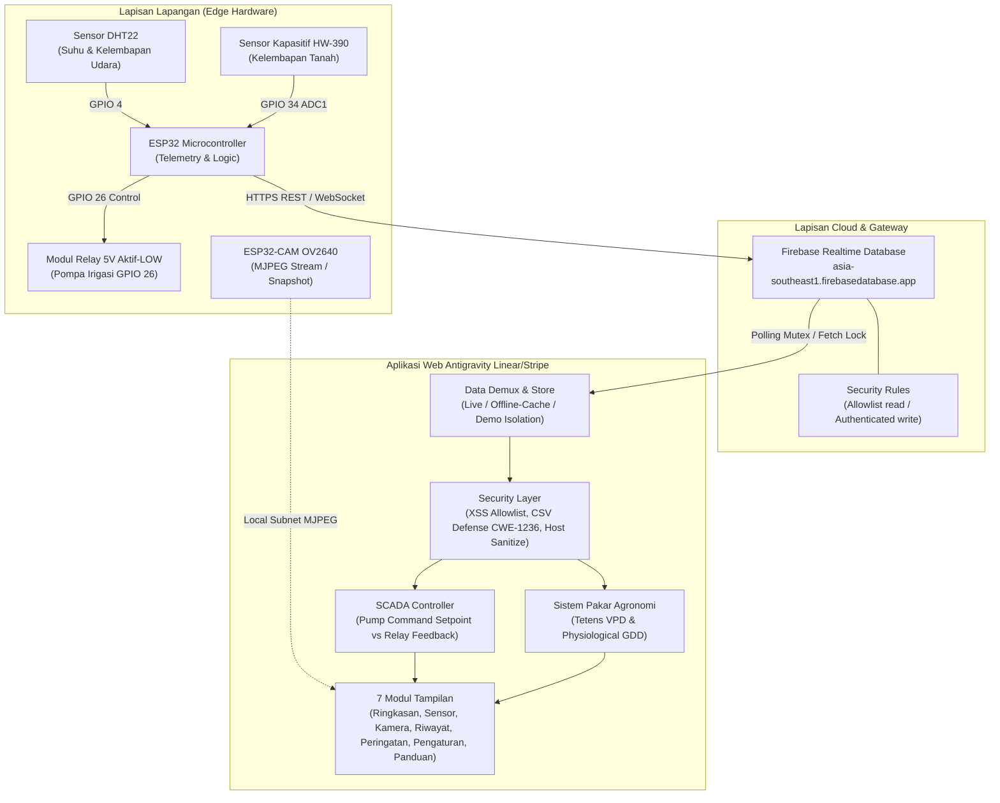

# Selada Keriting Smart Monitor & Irigasi Histeresis (Lactuca sativa L.)

Sistem telemetri IoT mikroklimat presisi, otomasi irigasi histeresis, dan Decision Support System (DSS) agronomi untuk budidaya selada keriting (*Lactuca sativa L.*). Dibangun dengan arsitektur web performa tinggi (Vanilla HTML5, CSS3 kustom Linear/Stripe dark aesthetic, dan ES6+ modular), terhubung secara serverless ke Firebase Realtime Database dan modul kamera ESP32-CAM.

---

## 1. Arsitektur Sistem & Alur Data



---

## 2. Fitur Utama & Hardening Keamanan

### A. Keamanan Aplikasi & Integritas Data (AppSec)
1. **Mitigasi DOM XSS**: Seluruh data yang berasal dari Firebase RTDB, input percakapan pengguna, maupun metadata kamera diproses menggunakan `SecurityUtils.escapeHTML` atau allowlist sanitasi `SecurityUtils.sanitizeHTML`. Manipulasi langsung via `innerHTML` berbahaya telah digantikan dengan DOM API aman dan escaping entitas.
2. **Pertahanan CSV Formula Injection (CWE-1236)**: Ekspor riwayat ke format CSV pada `generateCSV()` memvalidasi setiap kolom. Karakter pemicu formula eksekusi eksternal (`=`, `+`, `-`, `@`, `\t`, `\r`) diproteksi dengan prepending tanda kutip tunggal (`'`).
3. **Pemisahan Aliran Data (Data Segregation)**:
   - **Live Telemetry**: Data asli tervalidasi yang diterima dari Firebase RTDB.
   - **Offline Cache**: Data live yang dicache secara lokal (`localStorage`) saat jaringan terputus.
   - **Simulasi / Demo**: Buffer memori terisolasi. Data sintetis **tidak pernah** disimpan ke persistent cache `localStorage` agar tidak mencemari dataset riwayat.
4. **Validasi Sensor & Timestamp**:
   - Boundary checking ketat untuk suhu ($0 - 55^\circ\text{C}$), kelembapan udara ($5 - 100\%$), dan kelembapan tanah ($0 - 100\%$).
   - Anomali nilai `NaN`, `Infinity`, `null`, maupun kode error sensor (seperti `-999`) ditolak atau dinormalisasi ke fallback aman.
   - Timestamp masa lalu/masa depan di luar toleransi clock skew (> 60 detik) dinormalisasi ke waktu epoch saat ini.
5. **Keamanan Endpoint & ESP32-CAM (SSRF Defense)**:
   - Firebase endpoint diwajibkan menggunakan protokol `https:` dan domain resmi `firebasedatabase.app` / `firebaseio.com`.
   - Host kamera divalidasi ketat terhadap format IPv4 lokal/private atau hostname mDNS (`.local`), serta memblokir alamat link-local cloud metadata (`169.254.x.x`).

---

### B. Otomasi Irigasi & Logika Histeresis Pompa (SCADA Separation)
Irigasi selada keriting menggunakan pengontrol histeresis dua ambang batas (deadband control) untuk menjaga kelembapan tanah pada kapasitas lapang optimal dan mencegah switching relay berulang:

$$\text{Perintah Pompa} = \begin{cases} 
\text{ON} & \text{jika } \text{Kelembapan Tanah} < 65\% \\
\text{OFF} & \text{jika } \text{Kelembapan Tanah} > 78\% \\
\text{Status Sebelumnya} & \text{jika } 65\% \le \text{Kelembapan Tanah} \le 78\% \text{ (Deadband)}
\end{cases}$$

> [!IMPORTANT]
> **Pemisahan SCADA**: Dashboard membedakan secara tegas antara **Perintah Kontrol Otomatis (Set-point Command)** dengan **Konfirmasi Relay Hardware (Physical State)**. Sistem tidak pernah mengklaim pompa menyala secara fisik tanpa feedback sensor arus atau kontak balik relay aktual.

---

### C. Fisiologi Tanaman Selada Keriting (*Lactuca sativa L.*)
Sistem dilengkapi dengan **Decision Support System (DSS)** berbasis aturan ilmiah:

1. **Defisit Tekanan Uap (Vapor Pressure Deficit / VPD)**:
   Dihitung menggunakan formula Tetens:
   $$e_s = 0.61078 \times \exp\left(\frac{17.27 \times T}{T + 237.3}\right)\text{ kPa}$$
   $$VPD = e_s \times \left(1 - \frac{RH}{100}\right)\text{ kPa}$$
   - **Rentang Optimal Selada**: $0.45 - 0.90\text{ kPa}$.
   - **VPD Rendah ($< 0.40\text{ kPa}$)**: Transpirasi terhenti, risiko tinggi terjadinya **tipburn** (nekrosis kalsium pada pucuk daun muda).
   - **VPD Tinggi ($> 1.20\text{ kPa}$)**: Transpirasi berlebih memicu penutupan stomata dan layu sementara.
2. **Akumulasi Satuan Panas (Growing Degree Days / GDD)**:
   $$GDD = \sum \max\left(0, \min(T_{\text{rata-rata}}, T_{\text{cutoff}}) - T_{\text{base}}\right)$$
   - $T_{\text{base}} = 4.0^\circ\text{C}$ (ambang termal dasar vegetatif selada).
   - $T_{\text{cutoff}} = 28.0^\circ\text{C}$ (suhu di atas ambang batas meningkatkan akumulasi laktukopin pahit dan risiko *bolting* / pembungaan dini).
   - Target siklus vegetatif panen: $\approx 700\text{ GDD}$ ($\approx 40\text{ HST}$).

---

## 3. Struktur Repository & Modul

```
selada-workspace/
├── css/
│   └── style.css            # Tema gelap Linear/Stripe (#090d16, #111827), tabular-nums, responsive
├── js/
│   ├── firebase-config.js   # SecurityUtils, ConfigStore, FirebaseEdgeClient (Lock/Mutex, Cache)
│   ├── dashboard.js         # Navigation, SCADA Hysteresis Controller, Chart Engine, Camera Manager
│   ├── dataset.js           # DatasetStore, Pagination, Sorting, CSV Defense, Statistics
│   └── ai-assistant.js      # DSS Agronomi Selada, Tetens VPD, GDD thermal units, Chat Thread
├── tests/
│   └── run-all-tests.js     # Automated test suite (69 passed software tests, 4 hardware not-tested)
├── index.html               # 7 Tab UI (Ringkasan, Sensor, Kamera, Riwayat, Peringatan, Pengaturan, Panduan)
├── README.md                # Dokumentasi arsitektur, IoT pinout, dan keamanan sistem
└── .gitignore               # Konfigurasi ignore file lingkungan & OS
```

---

## 4. Konfigurasi Hardware ESP32 & Wiring

### Skema Pinout ESP32 Microcontroller
| Komponen | Pin Modul | Pin GPIO ESP32 | Keterangan |
| :--- | :--- | :--- | :--- |
| **DHT22** | DATA / OUT | **GPIO 4** | Memerlukan resistor pull-up $4.7\text{k}\Omega - 10\text{k}\Omega$ ke 3.3V |
| **DHT22** | VCC & GND | **3.3V & GND** | Pasokan daya stabil |
| **HW-390 / v1.2** | AOUT | **GPIO 34 (ADC1)** | Sensor kelembapan tanah kapasitif (bebas korosi elektrolisis) |
| **HW-390 / v1.2** | VCC & GND | **3.3V & GND** | Dihubungkan ke rail 3.3V untuk kalibrasi linier ADC |
| **Relay Modul** | IN | **GPIO 26** | Kontrol logika aktif-LOW (LOW = ON, HIGH = OFF) |
| **Relay Modul** | VCC & JD-VCC | **5V (VIN)** | Suplai coil relay terpisah untuk mencegah brownout MCU |

### Skema ESP32-CAM (OV2640)
- **Resolusi Streaming Rekomendasi**: SVGA ($800\times600$) atau VGA ($640\times480$) pada frame rate 10–15 FPS.
- **Port Layanan**: Port 80 (Web Control / Snapshot `/capture`) dan Port 81 (Stream `/stream`).
- **Validasi Host**: Masukkan IP lokal modul kamera pada menu Pengaturan (contoh: `192.168.1.105` atau `esp32cam.local`).

---

## 5. Struktur Payload Firebase Realtime Database

Data telemetri dikirimkan oleh ESP32 ke Firebase Realtime Database menggunakan skema JSON berikut:

```json
{
  "suhu": 24.5,
  "kelembapan_udara": 72.0,
  "kelembapan_tanah": 68.0,
  "status": "Optimal",
  "pompa": false,
  "timestamp": 1793437526000
}
```

### Rekomendasi Firebase Security Rules
```json
{
  "rules": {
    "kelompok2": {
      ".read": true,
      ".write": "auth != null"
    }
  }
}
```

---

## 6. Instalasi & Menjalankan Pengujian

### Menjalankan Local Web Server
```bash
# Menggunakan Python 3 built-in server
cd selada-workspace
python3 -m http.server 8080

# Akses via peramban:
# http://localhost:8080/
```

### Menjalankan Automated Test Suite
Test runner mandiri zero-dependency mengevaluasi 73 spesifikasi integritas dan keamanan:
```bash
cd selada-workspace
node tests/run-all-tests.js
```

Hasil verifikasi pengujian:
```text
================================================================
 TEST SUITE EXECUTION SUMMARY
================================================================
  Total Executed Tests : 73
  Passed (Verified)    : 69
  Failed               : 0
  Not Tested (Hardware): 4
================================================================
ALL TESTABLE SOFTWARE, SECURITY & INTEGRITY SPECS PASSED!
```

---

## 7. Keterbatasan Sistem & Troubleshooting

| Gejala | Penyebab Umum | Tindakan Penanganan |
| :--- | :--- | :--- |
| **Status "Offline Cache" atau "Mode Simulasi"** | Koneksi internet terputus atau URL Firebase tidak merespons | Periksa konfigurasi URL Firebase di menu Pengaturan. Pastikan endpoint menggunakan HTTPS dan berakhiran `.firebasedatabase.app`. |
| **Stream Kamera Tidak Tampil** | Mixed Content blocking atau IP kamera belum satu subnet | Pastikan peramban mengizinkan konten lokal jika membuka via HTTP, atau gunakan reverse proxy HTTPS lokal. Pastikan format IP valid (misal: `192.168.1.105`). |
| **Pompa Sering Mati-Hidup (Chattering)** | Sensor tanah berfluktuasi tepat di batas ambang | Sistem telah dilengkapi deadband histeresis ($65\% - 78\%$). Periksa filter sinyal analog kapasitif dan pastikan kabel sensor tanah terlindung dari derau induksi pompa. |
| **Relay State Berstatus "Tidak Tersedia"** | Firmware belum mengirim feedback relay fisik | Status ini normal untuk arsitektur open-loop. Untuk verifikasi fisik loop-tertutup, pasang sensor arus (ACS712) atau sambungkan auxiliary contact relay ke GPIO input ESP32. |

---

## 8. Lisensi & Kontribusi
Proyek ini dikembangkan di bawah lisensi terbuka untuk keperluan riset pertanian presisi dan edukasi teknik komputer (*Horticulture Internet of Things*).
