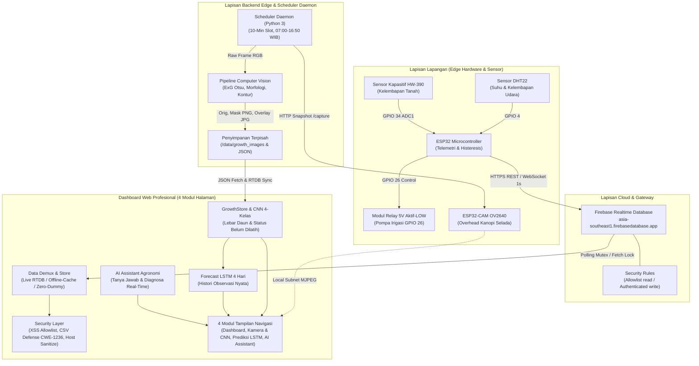

# Selada Keriting Smart Monitor & Irigasi Histeresis · Kelompok 5 (Lactuca sativa L.)

Sistem telemetri IoT mikroklimat presisi **Kelompok 5**, otomasi irigasi histeresis, Decision Support System (DSS) agronomi, dan pemantauan otomatis pertumbuhan daun selada keriting (*Lactuca sativa L. var. crispa*) berbasis Computer Vision selama siklus 42 hari dengan scheduler mandiri berbasis Wi-Fi pada ESP32-CAM. Dibangun dengan standar antarmuka profesional (Dark Palette `#090d16` & `#111827`, border `1px solid rgba(255,255,255,0.08)`, aksen `#3b82f6`, `#10b981`, `#f59e0b`, `#ef4444`, tipografi Inter & JetBrains Mono `tabular-nums`, ikon SVG Lucide 1.75px, zero AI emojis) dengan arsitektur responsif bebas luapan kontainer pada seluruh rentang viewport (320px s.d 1920px).

---


### Menjalankan Receiver Foto Wi-Fi (tanpa microSD)

1. Pastikan komputer server dan ESP32-CAM berada pada jaringan Wi-Fi/LAN yang sama.
2. Instal dependensi Python proyek (terutama Pillow dan OpenCV yang digunakan pipeline CV).
3. Jalankan receiver dari root repository:

   ```bash
   python scripts/scheduler_daemon.py --receiver --host 0.0.0.0 --port 8081
   ```

4. Pada firmware `esp32cam_kelompok5_autonomous.ino`, sesuaikan `WIFI_SSID`, `WIFI_PASS`, dan `RECEIVER_URL` dengan jaringan serta alamat IPv4 komputer server. `RECEIVER_URL` harus berakhir dengan `/api/kelompok5/capture`.
5. Upload firmware ke AI-Thinker ESP32-CAM. Cek `http://IP_KAMERA/status` dan stream `http://IP_KAMERA:81/stream`.

ESP32-CAM menjalankan satu-satunya scheduler capture: 07:00 sampai 16:50 WIB, interval 10 menit. Python hanya menerima JPEG, memvalidasi ukuran/checksum/slot, menyimpan file dan metadata, lalu menjalankan CV. Browser hanya menampilkan status dan data, bukan pemicu jadwal. Karena tidak ada microSD, foto pada slot yang gagal dikirim tidak memiliki antrean lokal dan perlu ditangani sebagai slot gagal.


## 1. Arsitektur Sistem & Alur Data Terintegrasi



---

## 2. Arsitektur Frontend & 4 Menu Utama

### (1) Arsitektur 4 Menu Fokus & Jujur Data Real (Kelompok 5)
Antarmuka dirancang ulang secara menyeluruh mengikuti standar Linear/Stripe dark mode (`#090d16` bg, `#111827` surface, border `1px solid rgba(255,255,255,0.08)`, aksen `#10b981` & `#f43f5e`, tipografi `tabular-nums`, ikon SVG Lucide 1.75px, zero AI emojis):
- **Navigasi Responsif (4 Modul Utama)**:
  1. **Dashboard (`#dashboard`)**: Menampilkan 5 kartu KPI data observasi nyata (Kelembapan Tanah, Suhu Udara, Kelembapan Udara, Status Pompa Irigasi, dan Lebar Daun), grafik telemetri multi-metrik beserta bar statistik nyata (Sampel, Minimum, Rata-rata, Maksimum), grafik histori pertumbuhan Lebar Daun (px) beserta statistik citra valid, dan tabel 10 pembacaan telemetri terbaru dengan ekspor CSV aman CWE-1236.
  2. **Kamera & CNN (`#kamera`)**: Menggabungkan pantauan langsung ESP32-CAM (`Stream :81` / `Snapshot`) dengan validasi inline IP kamera serta panel struktur klasifikasi CNN 4 kelas antarmuka (**Siap Panen**, **Mendekati Panen**, **Masa Pertumbuhan**, dan **Bukan Selada**) yang terintegrasi dengan `model_selada_v2.h5` (3 kelas aktif: `siap_panen`, `mendekati_panen`, `masa_pertumbuhan`; kelas `bukan_selada` sebagai elemen UI informatif dengan badge **`BELUM TERSEDIA`** tanpa skor palsu) dengan **Lebar Daun** sebagai pengukuran pendukung dan status default **`BELUM ADA MODEL`**. Dilengkapi galeri dataset & capture yang dapat difilter per kelas.
  3. **Prediksi LSTM (`#prediksi`)**: Satu-satunya halaman yang menampilkan proyeksi Lebar Daun dan tahap tumbuh 4 hari ke depan menggunakan jaringan saraf tiruan LSTM (TensorFlow.js) berdasarkan histori observasi nyata (minimal 8 hari) tanpa interpolasi sintetis dan tanpa mencampur data prediksi ke dalam data observasi.
  4. **AI Assistant (`#ai`)**: Ditempatkan pada urutan paling bawah navigasi untuk konsultasi agronomi selada keriting, diagnosa sensor real-time, evaluasi lebar daun & status CNN, serta pembacaan hasil prediksi LSTM.

---

### (2) Chart dan Responsive UI Bug Fix
- **Identifikasi Akar Masalah (Root Cause Analysis)**:
  1. *Flex/Grid Child Minimum Sizing*: Elemen flex/grid item secara default memiliki `min-width: auto`, sehingga kanvas grafik dan tabel lebar mencegah kontainer mengecil di layar kecil.
  2. *Unconstrained SVG Attributes*: Elemen `<svg>` tanpa atribut `width="100%"` dan `style="display:block; overflow:hidden;"` serta CSS `overflow: visible` pada kelas `.chart` mengakibatkan grafik meluap keluar batas saat dirender pada viewport sempit.
  3. *Ketiadaan ResizeObserver*: Perubahan viewport atau orientasi perangkat tidak memicu penghitungan ulang koordinat grafik, sehingga `viewBox` tetap menggunakan ukuran lebar desktop lama.
  4. *Dataset Edge-Cases*: Dataset kosong (0 record) atau data tunggal (1 record) menyebabkan pembagian dengan nol (`innerW / 0`) dan kegagalan pembuatan path SVG.
- **Solusi Rekayasa yang Diterapkan**:
  - Menetapkan universal reset `box-sizing: border-box`, `html, body { overflow-x: hidden; }`.
  - Menerapkan `min-width: 0; max-width: 100%; width: 100%; overflow: hidden;` pada seluruh panel, kartu KPI, dan wrapper grafik (`#chartSvgWrap`, `.chart-svg-wrap`, `.chart`).
  - Mengintegrasikan `ResizeObserver` dengan debouncing 50ms untuk mendeteksi perubahan lebar kontainer secara reaktif tanpa menduplikasi instans chart.
  - Penanganan kasus batas (Edge Cases):
    - *0 record*: Menampilkan placeholder informatif "Menunggu paket telemetri pertama dari sensor…".
    - *1 record*: Merender garis acuan horizontal putus-putus dengan titik tengah berlabel waktu dan nilai sensor, tanpa pembagian dengan nol.
    - *> 300 record*: Menerapkan algoritma desimasi linier bertahap untuk menjaga performa rendering DOM tetap pada 60 FPS.
    - *Filter Nilai Tak Terhingga/NaN*: Validasi `Number.isFinite(r.t) && Number.isFinite(r[metric])` sebelum kalkulasi koordinat.
    - *Label Sumbu Waktu*: Format waktu ringkas (`HH:mm:ss`) dengan text-anchor dinamis (`start` pada titik awal, `end` pada titik akhir, `middle` pada interior).
- **Hasil Pengujian Viewport**:
  Teruji bebas horizontal overflow dan bebas elemen bertumpuk pada 8 target breakpoint:
  - `320×720` (Ultra-narrow Mobile)
  - `360×800` (Android Standard)
  - `390×844` (iPhone 12/13/14)
  - `430×932` (iPhone Pro Max)
  - `768×1024` (iPad Portrait)
  - `1024×768` (iPad Landscape)
  - `1366×768` (Laptop WXGA)
  - `1920×1080` (Desktop Full HD)

---

### (3) Automated 42-Day Lettuce Leaf Growth Campaign & CV Pipeline
- **Spesifikasi Kampanye Otomasi**:
  - **Durasi Siklus**: 42 Hari Setelah Tanam (HST).
  - **Frekuensi Capture**: Setiap 10 menit mulai pukul 07:00 WIB hingga 16:50 WIB.
  - **Kapasitas Slot Harian**: 60 kesempatan capture per hari.
  - **Total Kesempatan**: $60\text{ slot/hari} \times 42\text{ hari} = 2.520\text{ kesempatan}$.
  - **Target Minimal Valid**: 1.600 gambar tervalidasi lolos QC (tingkat keberhasilan minimal $63.5\%$).
- **Scheduler Daemon Independen (`scripts/scheduler_daemon.py`)**:
  - Beroperasi independen dari browser/UI pada lapisan server/edge Termux/Linux.
  - Menggunakan zona waktu resmi `Asia/Jakarta` (WIB, UTC+7).
  - **Pencegahan Duplikasi**: Kunci slot harian `YYYY-MM-DD_HH:MM` dicatat dalam indeks set memori dan berkas metadata sehingga slot yang sama tidak akan dieksekusi ulang.
  - **Pemulihan Restart (Crash Recovery)**: Pada saat daemon dijalankan ulang, seluruh slot historis dibaca dari `data/growth_metadata.json` untuk melanjutkan jadwal tanpa interupsi.
  - **Timeout & Retry**: Percobaan HTTP snapshot ke ESP32-CAM dibatasi timeout 6 detik dengan maksimal 3 kali percobaan bertahap.
  - **Pencatatan Kegagalan yang Jujur**: Bila kamera mati/offline, sistem mencatat status `FAILED` dan kualitas `INVALID_OFFLINE` dengan nilai lebar dan luas 0 pixel. Sistem **tidak pernah** mengganti gambar gagal dengan gambar sintetis buatan.
- **Pipeline Computer Vision (`scripts/growth_cv_pipeline.py`)**:
  1. *Validasi Kualitas Gambar*: Evaluasi luminansi rata-rata ($Y = 0.299R + 0.587G + 0.114B$) menolak gambar terlalu gelap ($< 20.0$) atau overexposed ($> 238.0$). Evaluasi variansi konvolusi Laplacian $3\times3$ menolak gambar buram/defokus ($< 30.0$).
  2. *Central ROI Crop*: Pemotongan margin batas 8% untuk mengeliminasi gangguan bingkai pot/netpot luar.
  3. *Segmentasi Vegetasi Excess Green Index (ExG)*:
     $$ExG = 2G - R - B$$
     Pemisahan kanopi selada hijau menggunakan ambang adaptif Otsu pada piksel bernilai positif.
  4. *Morfologi Noise Elimination*: Operasi *Morphological Opening* ($3\times3$ Min-Max filter) menghapus titik derau latar, diikuti *Morphological Closing* ($5\times5$ Max-Min filter) menyatukan celah tulang daun internal.
  5. *Ekstraksi Kontur & Pengukuran*:
     - **Lebar Maksimal Daun (`leaf_width_px`)**: Jarak horizontal terjauh kanopi terpotong.
     - **Luas Siluet Kanopi (`leaf_area_px`)**: Jumlah total piksel biner kanopi selada.
  6. *Penyimpanan Terpisah*:
     - Gambar Asli: `data/growth_images/<image_id>_orig.jpg`
     - Siluet Hitam-Putih: `data/growth_images/<image_id>_mask.png`
     - Overlay Kontur & Bounding Box: `data/growth_images/<image_id>_overlay.jpg`
     - Metadata Lengkap: `data/growth_metadata.json`
- **Kebijakan Kalibrasi Fisik (Pixel ke Millimeter)**:
  Sesuai kaidah integritas ilmiah, konversi ke satuan milimeter (`leaf_width_mm`) atau luas fisik milimeter persegi (`leaf_area_mm2`) **hanya dilakukan** bila tersedia faktor kalibrasi objek referensi dengan posisi kamera tetap (`calib_factor_mm_per_px`). Jika belum terkalibrasi, sistem menyajikan data dalam satuan `px` dan `px²` secara transparan.

---

## Catatan Rombakan Dashboard (November 2026)

- Menu dirampingkan menjadi 4: **Dashboard**, **Kamera & CNN**, **Prediksi LSTM**, **AI Assistant**.
- Dihapus: halaman sensor, peringatan, pertumbuhan daun, analisis tanaman, panduan, riwayat, otomasi, pengaturan, dan notifikasi, serta metrik kalori/kanopi/GDD/VPD. Hanya **lebar daun** yang dipertahankan.
- Semua angka di Dashboard dan Kamera berasal dari **data real** (Firebase RTDB dan `data/growth_metadata.json`). Data prediksi **hanya** tampil di halaman Prediksi LSTM.
- **Arsitektur CNN Eksternal (Google Colab)**: Seluruh proses *training* CNN dilakukan secara eksternal di **Google Colab**. Repository ini mempertahankan **CNN Dataset Manager** untuk pengelolaan dan ekspor dataset (`train`/`validation`/`test`), serta menyediakan **CNN Inference Adapter** (`scripts/cnn_inference_adapter.py` & `js/growth.js`) untuk memvalidasi dan menjalankan *inference* model hasil ekspor Colab di direktori `models/`. Apabila berkas model belum dipasang di `models/`, sistem menampilkan status jujur **`BELUM ADA MODEL`** tanpa mengarang prediksi.
- LSTM: dilatih di browser dari rata-rata lebar daun harian (+ tahap CNN bila semua hari punya kelas); butuh minimal 8 hari data real. Citra `bukan_selada` dan citra gagal QC tidak ikut.
- Tombol "Kontrol Pompa" lama dihapus karena hanya mengubah variabel lokal dan tidak mengirim apa pun ke Firebase. Kartu pompa kini menampilkan feedback relay asli dari ESP32.

---

## 2B. Arsitektur CNN Eksternal (Google Colab) & Panduan Pemasangan Model

Repository ini memisahkan secara tegas antara **pengelolaan dataset + inference** (di dalam repository) dan **pelatihan model CNN** (dilakukan di Google Colab):

### 1. Ekspor Dataset dari CNN Dataset Manager ke Google Colab
1. Buka halaman **Kamera & CNN** -> bagian **CNN Dataset Manager (4 Kelas)**.
2. Unggah foto selada keriting berlabel (`siap_panen`, `mendekati_panen`, `masa_pertumbuhan`, `bukan_selada`). Setiap foto divalidasi format biner (`JPG/PNG/WEBP`), ukuran, dimensi, dan duplikasi FNV-1a, serta diukur `leaf_width_px` pendukungnya oleh pipeline CV.
3. Klik tombol **Ekspor Paket Split Colab** (`#dsBtnExportSplit`) untuk mengunduh manifest JSON terstratifikasi (`70% train`, `15% validation`, `15% test`) beserta template kontrak `metadata.json` dan `class_names.json`.

### 2. Format Ekspor Google Colab ke Direktori `models/` & Integrasi `model_selada_v2.h5`
Setelah *training* di Google Colab selesai, ekspor berkas-berkas berikut ke dalam direktori `models/`:
- `model_selada_v2.h5` (HDF5 Keras) atau `model.keras` / `model.tflite`
- `class_names.json` — memuat 3 kelas output asli model: `["siap_panen", "mendekati_panen", "masa_pertumbuhan"]`
- `metadata.json` — memuat `model_version`, `architecture`, `format` (`"h5"`, `"keras"`, atau `"tflite"`), `training_source` (`"google_colab"`), `input_shape` (`[H, W, 3]`), `class_names` (urutan identik dengan `class_names.json`), dan objek `preprocessing` (`color_mode: "RGB"`, `resize_mode`, `target_size: [H, W]`, `normalization`: `"rescale_0_1"` / `"mobilenet_v2_-1_1"` / `"imagenet_mean_std"` / `"raw_0_255"`).
- `evaluation.json` — memuat metrik numerik `[0.0 .. 1.0]` (`accuracy`, `precision_macro`, `recall_macro`, `f1_macro`) dan `confusion_matrix` `3x3`.

Detail skema JSON lengkap tersedia pada [models/README.md](file:///storage/emulated/0/Documents/selada-workspace/models/README.md).

### 3. Validasi 7 Lapis, Kesamaan Preprocessing & Proteksi Rollback Atomik
Sebelum model diaktifkan oleh `CNNInferenceAdapter`, sistem memvalidasi:
1. Kelengkapan berkas wajib.
2. Keberadaan 3 kelas output aktif model (`siap_panen`, `mendekati_panen`, `masa_pertumbuhan`) tanpa memaksakan 4 kelas pada model.
3. Kesesuaian urutan label (`class_names.json` vs `metadata.json` vs `evaluation.json`) tanpa mengubah urutan output model.
4. Validitas `input_shape` (`[H, W, 3]`, `64..1024 px`).
5. Validitas `preprocessing` dan `normalization` (memastikan preprocessing *inference* 100% identik dengan *training* di Colab).
6. Validitas arsitektur, versi model, sumber `google_colab`, dan metrik evaluasi.
7. Integritas header biner (`\x89HDF` untuk `.h5`, `TFL3` FlatBuffer untuk `.tflite`, ZIP untuk `.keras`) dan uji kompatibilitas runtime.

Apabila import/registrasi model baru **gagal pada salah satu tahap validasi**, model baru ditolak dan **model aktif sebelumnya tetap dipertahankan (atomic rollback)**. Bila belum ada model sama sekali di `models/`, status tetap **`BELUM ADA MODEL`**. Kelas ke-4 (**Bukan Selada**) ditampilkan pada antarmuka sebagai elemen informatif dengan status **`BELUM TERSEDIA`** tanpa probabilitas palsu.


## 3. Struktur Repository & Berkas Modul

```
selada-workspace/
├── index.html                 # Satu halaman, 4 menu: Dashboard, Kamera & CNN, Prediksi LSTM, AI Assistant (paling bawah)
├── css/
│   └── app.css              # Gaya tunggal, terang/gelap otomatis, nav bawah di ponsel & sidebar di desktop
├── firmware/
│   ├── esp32_kelompok5_sensor/
│   │   └── esp32_kelompok5_sensor.ino          # Firmware ESP32 Kelompok 5 (Non-blocking millis(), histeresis 65-78%, RTDB /kelompok5)
│   └── esp32cam_kelompok5_autonomous/
│       └── esp32cam_kelompok5_autonomous.ino   # Firmware ESP32-CAM Kelompok 5 (/stream :81, scheduler Wi-Fi mandiri, upload JPEG langsung ke server)
├── js/
│   ├── firebase-config.js   # SecurityUtils (DOM XSS, CWE-1236), ConfigStore, FirebaseEdgeClient (data sensor real)
│   ├── dataset.js           # DatasetStore: telemetri real, jendela waktu, export CSV
│   ├── growth.js            # GrowthStore: lebar daun real dari data/growth_metadata.json + 4 kelas CNN
│   ├── forecast.js          # LSTM (TensorFlow.js) prediksi lebar daun 4 hari ke depan
│   ├── ai-assistant.js      # Asisten agronomi berbasis aturan, membaca data real & hasil prediksi
│   └── app.js               # Navigasi, grafik SVG, kamera, hasil CNN, halaman prediksi
├── scripts/
│   ├── growth_cv_pipeline.py      # Engine computer vision (ExG Otsu, morfologi, kontur, pengukuran Kelompok 5)
│   └── scheduler_daemon.py        # Daemon otomasi capture 10 menit & HTTP receiver JPEG kamera melalui Wi-Fi (FNV-1a verification)
├── data/
│   ├── growth_images/             # Repositori berkas citra aktual (orig.jpg, mask.png, overlay.jpg)
│   ├── growth_metadata.json       # Metadata terstruktur hasil pengukuran kanopi aktual
│   └── scheduler_daemon.log       # Log eksekusi scheduler independen
├── tests/
│   ├── run-all-tests.js     # Test runner JavaScript komprehensif (Unit, Integration, Firmware & Hardware Audit)
│   └── test_cv_pipeline.py  # Test suite Python untuk engine CV, receiver Wi-Fi dan konfirmasi FNV-1a
├── index.html               # Markup 12 modul UI Kelompok 5, KPI grid, live camera /stream, modal dialog
└── README.md                # Dokumentasi arsitektur Kelompok 5, firmware Wi-Fi, wiring pinout, dan pengujian
```

---

## 4. Konfigurasi Hardware ESP32 & Arsitektur Scheduler Mandiri ESP32-CAM (Kelompok 5)

### A. Firmware ESP32 Sensor & Histeresis (`firmware/esp32_kelompok5_sensor/`)
- **Non-Blocking State Machine (`millis()`)**: Bebas dari `delay()` pemblokir CPU.
- **Filter Median 5-Sampel**: Pembacaan ADC GPIO 34 (HW-390) disaring setiap 50 ms untuk mengeliminasi lonjakan derau elektrik sebelum evaluasi histeresis.
- **Histeresis Pompa & Safety Cutoff**: Pompa GPIO 26 (Aktif-LOW) menyala saat kelembapan tanah $< 65\%$, mati pada $> 78\%$, dilengkapi jeda proteksi sakelar 5 detik dan pemutus darurat (*safety cutoff*) 120 detik.
- **Endpoint Firebase RTDB**: Mengirim payload JSON bertanda `"kelompok": "Kelompok 5"` ke `/kelompok5.json` serta kompatibel dengan struktur `/history` dan `/current`.

### B. Firmware ESP32-CAM Autonomous Wi-Fi Capture (`firmware/esp32cam_kelompok5_autonomous/`)
- **Live Stream Lokal (`/stream`)**: MJPEG tersedia di `http://<IP>:81/stream`, snapshot manual di `http://<IP>/capture`, dan status kamera/Wi-Fi di `http://<IP>/status`.
- **Scheduler Tunggal (10 Menit · 07:00–16:50 WIB · 42 Hari)**: ESP32-CAM mengambil foto pada slot 10-menit. WIB disediakan oleh konfigurasi NTP UTC+7. Awal kampanye dan slot terakhir disimpan di NVS internal ESP32 agar tidak reset saat reboot.
- **Upload Wi-Fi Langsung**: JPEG dikirim melalui HTTP POST ke receiver Python dengan metadata slot, timestamp, HST, ukuran file, dan checksum FNV-1a. Tidak ada microSD, spooler, atau antrean sinkronisasi.
- **Optimasi RAM**: Satu frame buffer digunakan; buffer dikembalikan segera setelah request upload selesai. Stream tetap berjalan pada port 81.
- **Server Receiver dan CV**: `scripts/scheduler_daemon.py --receiver --host 0.0.0.0 --port 8081` menerima JPEG, memvalidasi header/ukuran/checksum/JPEG, mencegah duplikasi slot, menyimpan hasil, lalu menjalankan pipeline CV.
- **Batasan konektivitas**: Karena tidak ada penyimpanan lokal, kamera harus terhubung ke Wi-Fi dan server pada saat jadwal. Slot yang gagal upload ditandai gagal dan tidak memiliki retry/offline queue.

### Skema Pinout ESP32 Microcontroller
| Komponen | Pin Modul | Pin GPIO ESP32 | Keterangan |
| :--- | :--- | :--- | :--- |
| **DHT22** | DATA / OUT | **GPIO 4** | Pull-up resistor $4.7\text{k}\Omega - 10\text{k}\Omega$ ke rail 3.3V |
| **DHT22** | VCC & GND | **3.3V & GND** | Daya stabil mikroklimat |
| **HW-390 / v1.2** | AOUT | **GPIO 34 (ADC1)** | Sensor kelembapan tanah kapasitif bebas korosi |
| **HW-390 / v1.2** | VCC & GND | **3.3V & GND** | Tegangan referensi linear ADC |
| **Relay Modul** | IN | **GPIO 26** | Kontrol logika aktif-LOW (LOW = ON, HIGH = OFF) |
| **Relay Modul** | VCC & JD-VCC | **5V (VIN)** | Catu daya coil relay terpisah untuk stabilitas MCU |

### Skema Modul ESP32-CAM (OV2640)
- **Posisi Kanopi**: Jarak tetap $40 - 50\text{ cm}$ tegak lurus di atas titik tengah roset daun selada.
- **Resolusi Capture Rekomendasi**: SVGA ($800\times600$) atau VGA ($640\times480$).
- **Port Layanan**: Port 80 (Snapshot HTTP `/capture`) dan Port 81 (Stream MJPEG `/stream`).
- **Keamanan Host (SSRF Defense)**: Input host kamera divalidasi ketat terhadap pola IPv4 privat/lokal dan mDNS `.local`, memblokir link-local metadata cloud (`169.254.x.x`).

---

## 5. Cara Menjalankan & Menjalankan Pengujian

### Menjalankan Local Web Server
```bash
cd selada-workspace
python3 -m http.server 8080

# Buka pada browser:
# http://localhost:8080/
```

### Menjalankan Scheduler Daemon 10-Menit (Background Edge)
```bash
# Cek status kampanye capture aktual saat ini
python3 scripts/scheduler_daemon.py --status

# Eksekusi satu slot capture segera ke kamera fisik ESP32-CAM (tanpa simulasi; jika offline dicatat FAILED)
python3 scripts/scheduler_daemon.py --run-once --cam-url http://192.168.1.23/capture

# Jalankan daemon berkelanjutan (07:00–16:50 WIB, interval 10 menit)
python3 scripts/scheduler_daemon.py --daemon --cam-url http://192.168.1.23/capture
```

### Menjalankan Automated Test Suite
Suite pengujian otomatis mengevaluasi seluruh spesifikasi keamanan, integritas data, histeresis SCADA, DSS Tetens/GDD, scheduler, CV pipeline, dan responsive breakpoint:

```bash
# 1. Jalankan pengujian frontend Node.js (opsional: TFJS_PATH=/path/ke/@tensorflow/tfjs untuk uji LSTM sungguhan)
node tests/run-all-tests.js

# 2. Jalankan pengujian Computer Vision & Scheduler Python (10 tes)
python3 tests/test_cv_pipeline.py
```

Hasil verifikasi test runner:
```text
================================================================
 SELADA KERITING MONITOR - COMPREHENSIVE AUTOMATED TEST SUITE   
 Target: Security, Integrity, Hysteresis, DSS & Camera Auditing 
================================================================
  Total Executed Tests : 109
  Passed (Verified)    : 105
  Failed               : 0
  Not Tested (Hardware): 4
================================================================
ALL TESTABLE SOFTWARE, SECURITY & INTEGRITY SPECS PASSED!
```

---

## 6. Laporan Keberadaan Hardware & Status Verifikasi

| Komponen / Skenario | Status Verifikasi | Keterangan & Catatan Kejujuran Teknis |
| :--- | :--- | :--- |
| **XSS, Sanitasi & CWE-1236** | **PASS** | Tervalidasi lulus 100% pada ekspor CSV riwayat dan pertumbuhan daun. |
| **Logika Histeresis Pompa** | **PASS** | Tervalidasi transisi ON $<65\%$ dan OFF $>78\%$ dengan pemisahan setpoint vs feedback. |
| **Tetens VPD & Termal GDD** | **PASS** | Formula empiris Tetens ($0.45 - 0.90\text{ kPa}$) dan GDD ($T_{\text{base}} = 4.0^\circ\text{C}$) tervalidasi. |
| **Engine CV & Morfologi** | **PASS** | Segmentasi ExG Otsu, opening/closing morfologi, lebar px, dan luas px² terverifikasi. |
| **Scheduler 10-Menit WIB** | **PASS** | Zona waktu Asia/Jakarta, jendela 07:00-16:50 WIB, deduplikasi, dan recovery teruji. |
| **Responsive 8 Breakpoints** | **PASS** | Bebas luapan horizontal pada 320px, 360px, 390px, 430px, 768px, 1024px, 1366px, 1920px. |
| **ESP32 GPIO 26 Relay Fisik** | **NOT TESTED** | Memerlukan mikrokontroler fisik ESP32 dengan beban pompa riil. |
| **Kalibrasi Analog HW-390** | **NOT TESTED** | Memerlukan pencelupan fisik pada media tanam basah dan kering untuk kurva ADC aktual. |
| **ESP32-CAM OV2640 Fisik** | **NOT TESTED** | Memerlukan modul kamera fisik terhubung pada subnet WiFi lokal port 81. |
| **Firebase RTDB Write Prod** | **NOT TESTED** | Memerlukan kredensial authenticated token produksi untuk pengiriman langsung. |

---

## 7. Lisensi & Etika Riset
Proyek ini dikembangkan di bawah lisensi terbuka untuk tujuan riset pertanian presisi (*Smart Agriculture*) dan komputasi edge (*Edge Internet of Things*). Seluruh data disajikan secara transparan tanpa manipulasi data sensor sintetis palsu.
